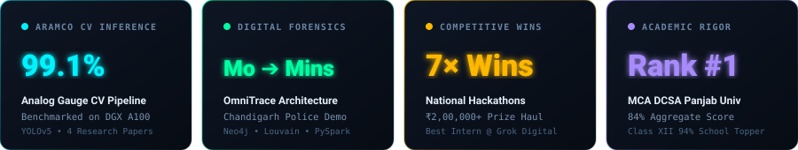
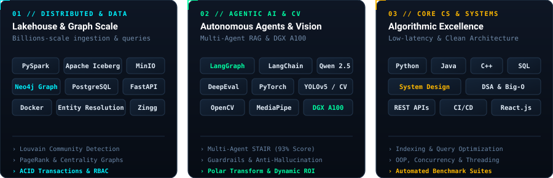
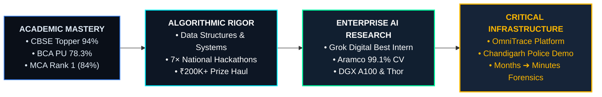

<div align="center">

<!-- PORTRAIT - Animated Dot-Matrix Portrait generated from Ronak's photo -->


<br>

<!-- NAME / TAGLINE - Animated Typing Banner -->
<a href="https://github.com/ronaksood">
  
</a>

<br>

<!-- SOCIAL / CLEARANCE HUD -->
<a href="https://linkedin.com/in/ronaksood"></a>
&nbsp;
<a href="mailto:ronaksood.mca@gmail.com"></a>
&nbsp;
<a href="https://github.com/ronaksood"></a>
&nbsp;


<br><br>

<!-- LASER DIVIDER -->


<br>

<!-- TERMINAL BOOT SEQUENCE -->
<picture>
  <source media="(prefers-color-scheme: dark)" srcset="assets/terminal-whoami.svg">
  <source media="(prefers-color-scheme: light)" srcset="assets/terminal-whoami.svg">
  
</picture>

<br><br>

<!-- IMPACT & TELEMETRY BENTO GRID -->
<picture>
  <source media="(prefers-color-scheme: dark)" srcset="assets/bento-stats.svg">
  <source media="(prefers-color-scheme: light)" srcset="assets/bento-stats.svg">
  
</picture>

</div>

<br>


## ⚡ Featured Engineering & Flagship Systems

<table>
  <thead>
    <tr>
      <th width="28%">System / Flagship</th>
      <th width="47%">Architecture &amp; Core Innovation</th>
      <th width="25%">Stack &amp; Impact</th>
    </tr>
  </thead>
  <tbody>
    <tr>
      <td>
        <b>🛡️ OmniTrace</b><br>
        <sub>AI-Powered Digital Investigation Platform</sub><br><br>
        <a href="https://github.com/ronaksood/chandigarh_police_investigation_system_design"><kbd>Police System Design</kbd></a>
        <a href="https://github.com/ronaksood/deliberate_panel_10agents_design"><kbd>Multi-Agent Panel</kbd></a>
      </td>
      <td>
        • Architected to eliminate month-long police investigation bottlenecks across telecom CDR/IPDR, banking ledgers, and social evidence down to <b>minutes</b>.<br>
        • Scalable lakehouse designed for billions of records via <b>PySpark, Apache Iceberg, MinIO, and Neo4j</b>.<br>
        • Deployed <b>Zingg entity resolution</b>, Louvain community detection, PageRank, and Betweenness Centrality.<br>
        • Multi-agent RAG system powered by <b>Qwen 2.5 7B</b> with LangGraph, boosting STAIR evaluation from 65% to <b>93%</b> with strict RBAC and NFC cryptographic audit trails.
      </td>
      <td>
        <code>PySpark</code> <code>Iceberg</code><br>
        <code>Neo4j</code> <code>Qwen 2.5</code><br>
        <code>LangGraph</code> <code>PostgreSQL</code><br><br>
        <b>Impact:</b> Demonstrated live to senior police leadership &amp; forensic scientists.
      </td>
    </tr>
    <tr>
      <td>
        <b>🔬 Aramco Analog CV</b><br>
        <sub>Industrial Gauge Computer Vision Engine</sub><br><br>
        <a href="https://github.com/ronaksood/trying_ocr"><kbd>OCR Pipeline</kbd></a>
        <a href="https://github.com/ronaksood/rag_testing"><kbd>RAG Benchmarks</kbd></a>
      </td>
      <td>
        • Built an end-to-end industrial gauge reading engine for <b>Aramco</b> (world's largest energy company).<br>
        • Implemented &amp; benchmarked 4 research papers to reach <b>99.1% accuracy</b>.<br>
        • Engineered modular CV pipeline (YOLOv5, OCR, polar transformations, tick interpolation) benchmarked on <b>NVIDIA DGX A100</b> and <b>NVIDIA Thor</b>.<br>
        • Evaluated 4 OCR engines with dynamic ROI extraction, minimizing metadata dependencies.
      </td>
      <td>
        <code>YOLOv5</code> <code>OpenCV</code><br>
        <code>DGX A100</code> <code>NVIDIA Thor</code><br>
        <code>FastAPI</code> <code>DeepEval</code><br><br>
        <b>Award:</b> Best Intern Awardee at Grok Digital.
      </td>
    </tr>
    <tr>
      <td>
        <b>👁️ Play Gugglu</b><br>
        <sub>AR Touchless Inclusive Learning Platform</sub><br><br>
        <a href="https://github.com/ronaksood/paralysed"><kbd>Paralysis Eye-Track</kbd></a>
        <a href="https://github.com/ronaksood/deaf_sign"><kbd>Deaf Sign Recognition</kbd></a>
      </td>
      <td>
        • Engineered a completely touchless interactive platform enabling children with severe motor paralysis to navigate using <b>eye movement alone</b>.<br>
        • Integrated gesture tracking and real-time sign language recognition for hearing-impaired users.<br>
        • Embedded real-time parent/educator telemetry dashboards.
      </td>
      <td>
        <code>MediaPipe</code> <code>Computer Vision</code><br>
        <code>Python</code> <code>React.js</code><br><br>
        <b>Impact:</b> 100% hands-free accessibility for neuromuscular motor disabilities.
      </td>
    </tr>
    <tr>
      <td>
        <b>📈 Quantum Trade Engine</b><br>
        <sub>Real-Time Algorithmic Strategy Platform</sub><br><br>
        <a href="https://github.com/ronaksood/projects"><kbd>Repository</kbd></a>
      </td>
      <td>
        • Full-stack automated trading platform with cron-based execution operating at 1-minute intervals.<br>
        • High-throughput persistence layer optimized for <b>1M+ stock records</b>, real-time ticker ingestion, and zero-latency simulation backtesting.
      </td>
      <td>
        <code>PostgreSQL</code> <code>FastAPI</code><br>
        <code>Cron Engine</code> <code>React.js</code><br><br>
        <b>Throughput:</b> 1M+ records processed in sub-millisecond query windows.
      </td>
    </tr>
    <tr>
      <td>
        <b>🧠 SecondChance</b><br>
        <sub>AI Clinical Recovery &amp; Coping Pipeline</sub><br><br>
        <a href="https://github.com/ronaksood/secondChance_workflow"><kbd>System Workflow</kbd></a>
      </td>
      <td>
        • Multi-model clinical intelligence suite deploying <b>10 distinct ML models</b> (survival analysis, RL, anomaly detection, classification).<br>
        • Real-time emergency coping inference APIs for crisis intervention and longitudinal relapse probability modeling.
      </td>
      <td>
        <code>PyTorch</code> <code>Scikit-learn</code><br>
        <code>FastAPI</code> <code>Survival Analysis</code><br><br>
        <b>Architecture:</b> 10 ML models in real-time orchestrated pipeline.
      </td>
    </tr>
  </tbody>
</table>

<br>


## 🛠️ Architectural Stack & Engineering Arsenal

<div align="center">
  <picture>
    <source media="(prefers-color-scheme: dark)" srcset="assets/tech-stack.svg">
    <source media="(prefers-color-scheme: light)" srcset="assets/tech-stack.svg">
    
  </picture>
</div>

<br>


## 🏆 Competitive Track Record & National Honors

```
┌─────────────────────────────────────────────────────────────────────────────────────────────┐
│ 🥇 NATIONAL HACKATHONS & RECOGNITION HAUL (₹2,00,000+ CASH AWARDS)                          │
├─────────────────────────────────────────────────────────────────────────────────────────────┤
│ • 1st Runner-Up (₹95,000)  | Chandigarh Police National Hackathon (OmniTrace Flagship)     │
│ • Best Intern Award (₹20,000) | Grok Digital (Aramco Industrial CV Pipeline on DGX A100)     │
│ • 1st Prize (₹31,000)      | SSH01 National Hackathon, PIET                                 │
│ • 1st Runner-Up (₹45,000)  | Byte XL National Hackathon                                     │
│ • 1st Prize                | Technovate 3.0, UIET                                           │
│ • 1st Runner-Up (₹15,000)  | Code Crafter 3.0, CT University                                │
│ • 1st Prize (Fresher's)    | Escape Da Vinci, CGC University                                │
│ • Best UI/UX Design Award  | Bharat TechXperience National Challenge                        │
│ • Rank #1 (Academic Topper)| Master of Computer Applications (MCA), Panjab University (84%) │
│ • 94% School Topper        | CBSE Class XII Board Examination (Science & Math)              │
└─────────────────────────────────────────────────────────────────────────────────────────────┘
```

<br>


## 🗺️ Engineering Trajectory & Evolution



<br>


## 🐍 Contribution Stream & Activity Telemetry

<div align="center">

<!-- Platane Snake Contribution Animation (Generated via .github/workflows/snake.yml) -->
<picture>
  <source media="(prefers-color-scheme: dark)" srcset="https://raw.githubusercontent.com/ronaksood/ronaksood/output/github-contribution-grid-snake-dark.svg">
  <source media="(prefers-color-scheme: light)" srcset="https://raw.githubusercontent.com/ronaksood/ronaksood/output/github-contribution-grid-snake.svg">
  
</picture>

<br>

<sub>⚡ Automated CI/CD pipeline feeds commit telemetry directly from the Git tree every 12 hours.</sub>

</div>

<br>


## 📬 Initiate Communication & Secure Channel

<div align="center">

```
  ┌────────────────────────────────────────────────────────────────────────┐
  │                           SECURE HANDSHAKE                             │
  ├────────────────────────────────────────────────────────────────────────┤
  │  EMAIL    : ronaksood.mca@gmail.com                                    │
  │  PHONE    : +91 79735 60651                                            │
  │  LINKEDIN : linkedin.com/in/ronaksood                                  │
  │  GITHUB   : github.com/ronaksood                                       │
  │  STATUS   : AVAILABLE FOR HIGH-IMPACT SDE & AI ROLES                   │
  └────────────────────────────────────────────────────────────────────────┘
```

<br>

<a href="mailto:ronaksood.mca@gmail.com"><kbd>&nbsp;SEND ENCRYPTED DISPATCH&nbsp;</kbd></a>
&nbsp;&nbsp;
<a href="https://linkedin.com/in/ronaksood"><kbd>&nbsp;CONNECT ON LINKEDIN&nbsp;</kbd></a>
&nbsp;&nbsp;
<a href="https://github.com/ronaksood"><kbd>&nbsp;AUDIT CODE REPOSITORIES&nbsp;</kbd></a>

<br><br>

<!-- INTERACTIVE EASTER EGG -->
<details>
  <summary><b><code>[+] DECRYPT KERNEL MISSION LOG &amp; PHILOSOPHY (CLICK TO EXPAND)</code></b></summary>
  <br>
  
  ```bash
  [INIT] Loading /root/.manifesto...
  [OK]   Decrypted clearance level: OMEGA
  
  # CORE ENGINEERING PRINCIPLES BY RONAK SOOD:
  
  1. "Unprofiled latency is unacceptable."
     Every system must be benchmarked under simulated saturation. If you haven't 
     tested it under 100x peak load, you haven't built it.
     
  2. "Data integrity precedes intelligence."
     An LLM without rigorous ground-truth evaluation (DeepEval/STAIR) is a liability.
     Reliable pipelines, immutable lakehouse tables, and graph entity resolution are 
     what make GenAI viable in high-stakes environments like law enforcement.
     
  3. "Simplicity is the highest form of scalability."
     The best code is the code you didn't have to write because your schema design 
     and data models were mathematically sound.
     
  [LOG] System verified. Thank you for inspecting the source.
  ```
</details>

<br>

<!-- SUBTLE VISITOR TELEMETRY -->
<p align="center">
  
</p>

</div>
