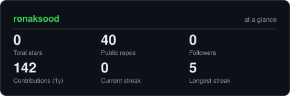
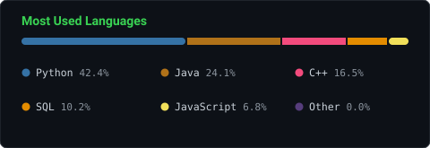
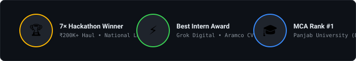
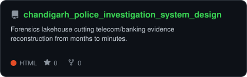
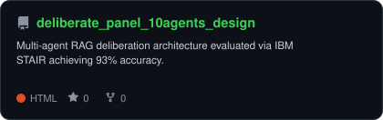
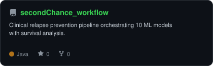
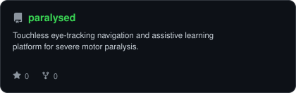

<div align="center">

<!-- PORTRAIT - generated by scripts/dotify.py from user photo.
     Colour mode, so one file serves both GitHub themes. -->


<br>

<!-- NAME / TAGLINE - animated typing -->
<a href="https://github.com/ronaksood">
  
</a>

<br>

<!-- SOCIALS -->
<a href="https://linkedin.com/in/ronaksood"></a>
<a href="mailto:ronaksood.mca@gmail.com"></a>
<a href="https://github.com/ronaksood"></a>


</div>

---

## `~/` whoami

```console
$ cat about.txt
```

Hi, I'm **Ronak Sood**. I build high-throughput backend architectures, scalable data pipelines, and agentic AI systems that solve real-world forensic and industrial scale problems.

- Currently building **[OmniTrace](https://github.com/ronaksood/chandigarh_police_investigation_system_design)** (forensic lakehouse cutting police evidence analysis from months to minutes) and **[Multi-Agent Deliberation Panel](https://github.com/ronaksood/deliberate_panel_10agents_design)**
- Enterprise Research: **Engineered industrial gauge CV for Aramco (Best Intern Awardee @ Grok Digital) on NVIDIA DGX A100 & Thor (99.1% accuracy)**
- Learning & Exploring: **Distributed Vector Indexing + STAIR Multi-Agent Orchestration (93% evaluation)**
- Fun fact: **7× National Hackathon Champion (₹2,00,000+ prize haul) and MCA Rank #1 at Panjab University (84%).**

<br>

<div align="center">

## `~/` toolbox


</div>

---

<div align="center">

## `~/` skill radar

<table>
<tr>
<td width="50%" align="center" valign="middle">

<!-- Self-rated radar - edit assets/skills.json, the workflow redraws it -->
<picture>
  <source media="(prefers-color-scheme: dark)"  srcset="assets/radar-dark.svg">
  <source media="(prefers-color-scheme: light)" srcset="assets/radar-light.svg">
  
</picture>

</td>
<td width="50%" align="center" valign="middle">

<!-- Live radar built from real language byte counts across your repos -->
<picture>
  <source media="(prefers-color-scheme: dark)"  srcset="assets/radar-langs-dark.svg">
  <source media="(prefers-color-scheme: light)" srcset="assets/radar-langs-light.svg">
  
</picture>

</td>
</tr>
</table>

</div>

---

<div align="center">

## `~/` contribution calendar

<!-- 3D isometric calendar, regenerated every 6h by .github/workflows/metrics.yml -->


<br><br>

<!-- Snake eats the contribution graph - .github/workflows/snake.yml -->
<picture>
  <source media="(prefers-color-scheme: dark)"  srcset="https://raw.githubusercontent.com/ronaksood/ronaksood/output/github-contribution-grid-snake-dark.svg">
  <source media="(prefers-color-scheme: light)" srcset="https://raw.githubusercontent.com/ronaksood/ronaksood/output/github-contribution-grid-snake.svg">
  
</picture>

</div>

---

<div align="center">

## `~/` the numbers

<!-- Generated by scripts/cards.py into this repo. Deliberately NOT
     github-readme-stats / streak-stats / github-profile-trophy: those are
     shared public instances that go down and take the whole section with them. -->
<picture>
  <source media="(prefers-color-scheme: dark)"  srcset="assets/card-stats-dark.svg">
  <source media="(prefers-color-scheme: light)" srcset="assets/card-stats-light.svg">
  
</picture>

<br>



<br><br>



</div>

---

<div align="center">

## `~/` selected work

<!-- Cards generated by scripts/cards.py from assets/projects.json.
     Stars, forks and language are pulled live from the API on every run. -->
<table>
<tr>
<td width="50%">
  <a href="https://github.com/ronaksood/chandigarh_police_investigation_system_design">
    <picture>
      <source media="(prefers-color-scheme: dark)"  srcset="assets/card-chandigarh_police_investigation_system_design-dark.svg">
      <source media="(prefers-color-scheme: light)" srcset="assets/card-chandigarh_police_investigation_system_design-light.svg">
      
    </picture>
  </a>
</td>
<td width="50%">
  <a href="https://github.com/ronaksood/deliberate_panel_10agents_design">
    <picture>
      <source media="(prefers-color-scheme: dark)"  srcset="assets/card-deliberate_panel_10agents_design-dark.svg">
      <source media="(prefers-color-scheme: light)" srcset="assets/card-deliberate_panel_10agents_design-light.svg">
      
    </picture>
  </a>
</td>
</tr>
<tr>
<td width="50%">
  <a href="https://github.com/ronaksood/secondChance_workflow">
    <picture>
      <source media="(prefers-color-scheme: dark)"  srcset="assets/card-secondChance_workflow-dark.svg">
      <source media="(prefers-color-scheme: light)" srcset="assets/card-secondChance_workflow-light.svg">
      
    </picture>
  </a>
</td>
<td width="50%">
  <a href="https://github.com/ronaksood/paralysed">
    <picture>
      <source media="(prefers-color-scheme: dark)"  srcset="assets/card-paralysed-dark.svg">
      <source media="(prefers-color-scheme: light)" srcset="assets/card-paralysed-light.svg">
      
    </picture>
  </a>
</td>
</tr>
</table>

<sub>

| project | live / docs | stack |
|---|---|---|
| **[OmniTrace](https://github.com/ronaksood/chandigarh_police_investigation_system_design)** | [Chandigarh Police Forensic Demo](https://github.com/ronaksood/chandigarh_police_investigation_system_design) | `PySpark` `Iceberg` `Neo4j` `MinIO` |
| **[Multi-Agent STAIR](https://github.com/ronaksood/deliberate_panel_10agents_design)** | [93% Evaluation Architecture](https://github.com/ronaksood/deliberate_panel_10agents_design) | `LangGraph` `Qwen 2.5 7B` `DeepEval` |
| **[SecondChance](https://github.com/ronaksood/secondChance_workflow)** | [10-Model Recovery Pipeline](https://github.com/ronaksood/secondChance_workflow) | `PyTorch` `Scikit-learn` `FastAPI` |
| **[Play Gugglu](https://github.com/ronaksood/paralysed)** | [Touchless Eye-Tracking Assistive](https://github.com/ronaksood/paralysed) | `MediaPipe` `Computer Vision` `React` |

</sub>

</div>

---

<div align="center">

<sub>`01110100 01101000 01100001 01101110 01101011 01110011 00100000 01100110 01101111 01110010 00100000 01110011 01100011 01110010 01101111 01101100 01101100 01101001 01101110 01100111`</sub>

</div>
